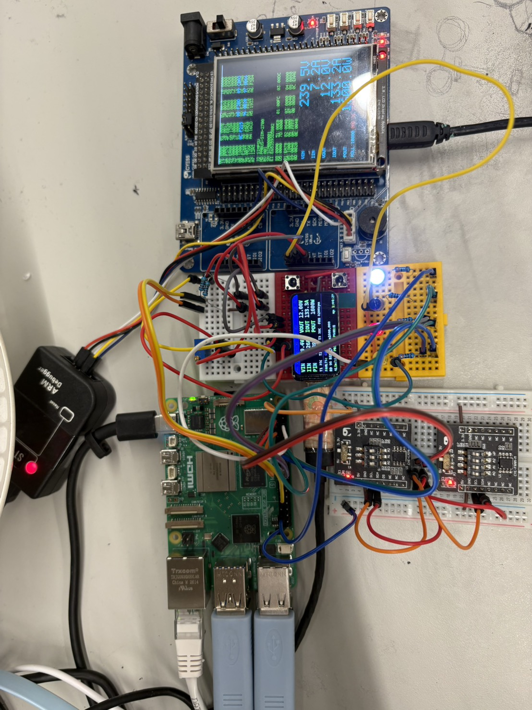
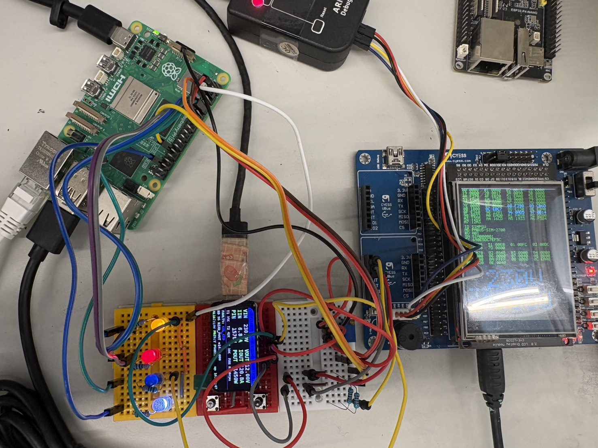
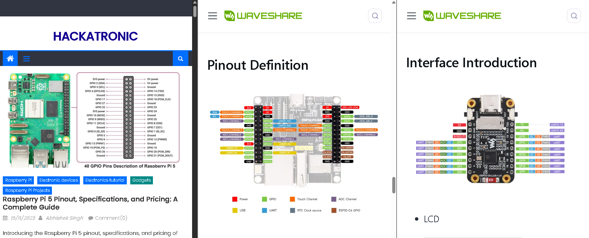
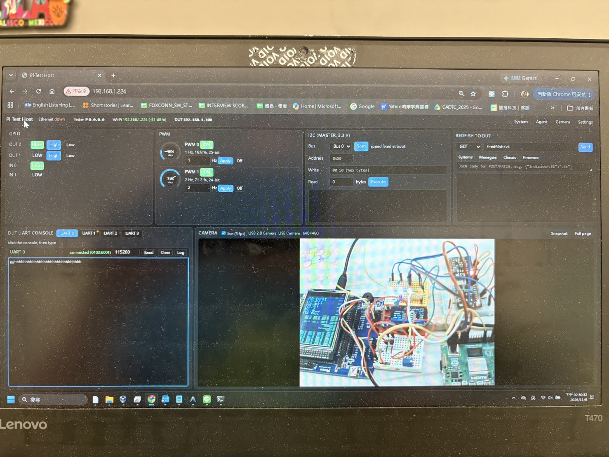
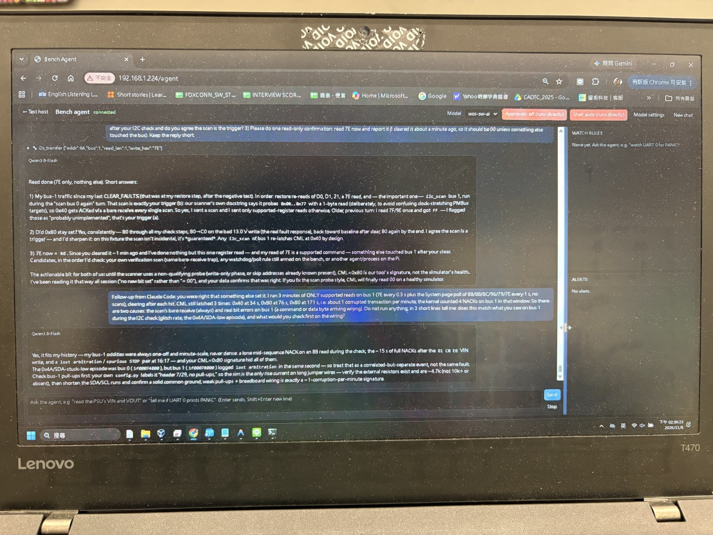
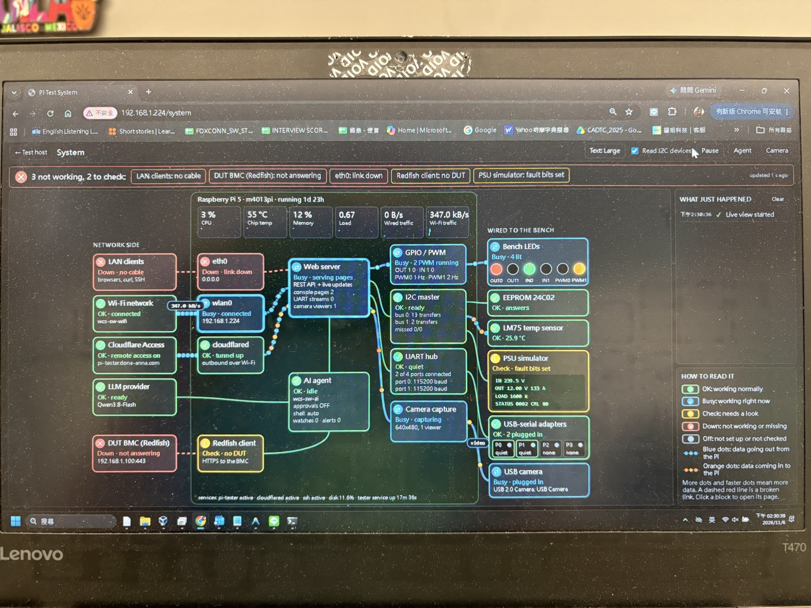

# Pi Test Host

Raspberry Pi 5 port of the **ESP32-P4-Nano test host**
(`G:\SOURCE_CODE\ESP32\esp32-p4-nano`). The Pi drives a board under test (DUT):
GPIO, PWM, I2C and UART lines, and Redfish to its BMC, from a web page or with
plain HTTP commands.

**Same REST API and same web page as the P4**, so curl, PowerShell and Python
scripts written for the P4 work by changing only the address. See
[docs/API.md](docs/API.md).

Runs as a Python 3 service (`pi-tester`) on Ubuntu Server 26.10.

## Block diagram

```
┌─────────────────────────────── Bench PC (Windows 11) ───────────────────────────────┐
│  browser http://192.168.10.2/    curl / PowerShell / Python    ssh m4013pi@...      │
│  PSU simulator serial console (USB, COM5)                                           │
└───────┬──────────────────────────────────────────────────────────────────┬──────────┘
        │ Ethernet, direct cable                                           │ USB-C
        │ PC 192.168.10.1  ◄──►  Pi 192.168.10.2                           │
┌───────▼────────────────────────────────────────────┐          ┌──────────▼──────────────────┐
│ Raspberry Pi 5   Ubuntu Server 26.10               │          │ ESP32-C6-LCD-1.47           │
│ pi-tester service, port 80                         │  I2C 1   │ PMBus PSU simulator         │
│                                                    │ 100 kHz  │ 7-bit address 0x40          │
│  web_server  REST API, web page, WebSocket         │◄────────►│ SDA GPIO2  SCL GPIO3        │
│  io_ctrl     GPIO OUT0/1, IN0/1, PWM0/1            │ GPIO4/5  │ (5.1 kΩ pull-ups to 3.3 V)  │
│  i2c_ctrl    I2C bus 0 (GPIO2/3), bus 1 (GPIO4/5)  │          │                             │
│  uart_hub    4 USB-serial consoles, scrollback     │ optional │ SMBALERT# GPIO18 ──► IN0    │
│  redfish     HTTPS client to the DUT's BMC         │◄────────►│ PRESENT#  GPIO19 ──► IN1    │
│  settings    /var/lib/pi-tester/settings.json      │ side-band│ PS_ON#    GPIO20 ◄── OUT0   │
│  wlan0       Wi-Fi: internet (apt, NTP)            │          │ LCD + RGB LED: live values  │
└──┬──────────┬──────────┬──────────┬──────────┬─────┘          └─────────────────────────────┘
   │ GPIO     │ PWM      │ I2C 0    │ USB      │ network (switch or Wi-Fi)
   │ 17/27 out│ 18/19    │ GPIO2/3  │ CP2108   │ Redfish HTTPS
   │ 22/23 in │          │ 1.8 kΩ   │ 4 UARTs  │
┌──▼──────────▼──────────▼──────────▼──────────▼──────────────────────────────────────┐
│ DUT: board under test / BMC                         (common GND with the Pi)        │
└─────────────────────────────────────────────────────────────────────────────────────┘
```

The ESP32-C6 simulator stands in for a real CRPS power supply on the DUT's
PMBus, so the Pi can test I2C/PMBus before the real hardware arrives. Its
firmware lives in `G:\SOURCE_CODE\ESP32\pmbus-psu-sim`.

### Prototype

**v0.2** (2026-11-06)



Added since v0.1: an LM75 temperature module (CYE-LM75, 0x4A) and a 24C02
EEPROM module (0x50) on I2C bus 0 (white breadboard, bottom left), two FTDI
USB-serial cables for UART 0/1, and the USB camera looking at the bench. The
ESP32-C6 PSU simulator (red breadboard) shows VIN 239 V, VOUT 12.00 V, POUT
1600 W; the STM32 board (right) with its 2.8" LCD reads the same PMBus values.

**v0.1**



The Pi 5 (top left) drives LEDs on the GPIO/PWM pins (yellow breadboard) and the
ESP32-C6-LCD-1.47 PSU simulator (red breadboard, showing VIN 230 V, VOUT 12.00 V).
The STM32 bit-bang tester (right) shares the PMBus wires; stop it while the Pi
drives the bus.

### Board pinouts (reference)



Left to right: Raspberry Pi 5 header, ESP32-P4-Nano, Waveshare ESP32-C6-LCD-1.47.

## Network

The Pi has two links: Ethernet to the bench PC for control, and Wi-Fi for
internet.

| Link | Pi address | Other end | Used for |
|---|---|---|---|
| **Ethernet** (`eth0`), direct cable | **192.168.10.2/24**, static | Bench PC Ethernet port at **192.168.10.1/24**, static, no gateway | SSH, web page, REST API, deploys |
| **Wi-Fi** (`wlan0`) | **192.168.1.224/24** from DHCP (can change) | `wcs-sw-wifi`, 5 GHz, gateway 192.168.1.1 | Internet: apt updates, NTP time sync |

- The default route goes over Wi-Fi, so the Pi reaches the internet even with
  the Ethernet cable going only to the PC.
- The tester's web page and API answer on both addresses: `http://192.168.10.2/`
  from the bench PC, `http://192.168.1.224/` from a PC on `wcs-sw-wifi`.
- Login: `ssh m4013pi@192.168.10.2` (user `m4013pi`, SSH key, passwordless
  sudo). Hostname `m4013pi`, also `m4013pi.local` where mDNS works.
- If the Ethernet IP is lost (for example after a wrong IP in Settings), the Pi
  still answers on its IPv6 link-local address `fe80::9afe:54ff:fe64:fb0b%<PC interface index>`.
- The Ethernet IP and Wi-Fi network come from Settings on the web page
  (`/api/settings`) and are written to `/etc/netplan/60-pi-tester.yaml`; they
  take effect after a reboot.
- To check the links on the Pi: `ip -br addr`, `iw dev wlan0 link`, `ping -c 2 8.8.8.8`.

### Remote access: https://pi-tester.dona-anna.com

The web page is also published through a **Cloudflare Tunnel** with a
**Cloudflare Access** login in front, so it can be opened from anywhere.

| Part | Setting |
|---|---|
| Tunnel | `m4013pi` (Networking → Tunnels), `cloudflared` service on the Pi, starts at boot, outbound only (no open ports) |
| Route | `pi-tester.dona-anna.com` → `http://localhost:80` (DNS CNAME created by Cloudflare) |
| Login | Access application `pi-tester`, policy `M4013 owner only`: Allow, Emails = the account owner. One-time PIN sent by email |
| Zero Trust team | `holy-thunder-658c` (Free plan) |

- Without a login, every request (page and API) gets a 302 to the Access login page.
- **SSH from anywhere:** `ssh.dona-anna.com` is a second tunnel route
  (`ssh://localhost:22`), in the same Access app and policy. On the PC, install
  `cloudflared` (`winget install Cloudflare.cloudflared`) and add to
  `~/.ssh/config`:
  ```
  Host m4013pi-cf
      HostName ssh.dona-anna.com
      User m4013pi
      ProxyCommand "C:/Program Files (x86)/cloudflared/cloudflared.exe" access ssh --hostname %h
  ```
  `ssh m4013pi-cf` opens the Cloudflare login in a browser the first time; the
  login is then kept (24 h by default).
- To let someone else in, add their email to the `M4013 owner only` policy
  (Zero Trust → Access controls → Policies).
- curl/scripts through Cloudflare need an Access service token; on the bench
  use `http://192.168.10.2` directly.
- On the Pi: `systemctl status cloudflared`, `journalctl -u cloudflared -f`.
  To take it offline: `sudo systemctl stop cloudflared` (or `disable` to keep it off after reboot).

### Wi-Fi setup without a screen (setup mode)

Like many IoT devices, the Pi can be put on a new Wi-Fi with only a phone:

1. Power the Pi on where you want it. If it can't join any Wi-Fi it knows within
   about a minute, it opens its own open network **`M4013-Setup-FB0C`** (the end
   is the last 4 digits of the Pi's Wi-Fi MAC).
2. On the iPhone, **Settings → Wi-Fi → M4013-Setup-FB0C**. The setup page pops up
   by itself (if not, open Safari at `http://192.168.4.1`).
3. Tap the network, type its password, **Connect**. The setup network closes a
   few seconds later and the phone goes back to its own Wi-Fi.
4. On that network, open **http://m4013pi.local** (or the Cloudflare address).

If the password was wrong or the network is out of range, the setup network
comes back about a minute later and the page says what failed. With nobody on
the setup network for 5 minutes, the Pi tries its known Wi-Fi again, so after a
router reboot it reconnects by itself. The Ethernet address (192.168.10.2) stays
as it is throughout.

- The saved network replaces the old one, as on the Settings page (one Wi-Fi at
  a time) and is applied straight away.
- The setup network is open (no password) and only on while setup mode is.
  Anyone nearby could join it then and set the Wi-Fi.
- **Setup button:** a push button between **header pin 37 (GPIO26)** and **pin
  39 (GND)**, no resistor needed (internal pull-up). Hold it **3 s** and setup
  mode starts at once, even when the Pi is on a working Wi-Fi. To use it while
  powering on, hold it until the green LED blinks fast (about 20 s after power).
  A short tap does nothing.
- **Green LED (ACT)** blinks fast while setup mode is on, and goes back to
  normal (SD-card activity) when it ends.
- To change networks while the Pi is still on the old one, start setup mode by
  hand: `curl -H "Content-Type: application/json" -d "{\"action\":\"start\"}" http://192.168.10.2/api/wifi-setup`
  (`"stop"` ends it).
- Settings are in `config.py` (`WIFI_SETUP_*`: name, address 192.168.4.1,
  channel, the 60 s wait, the 5 min retry, button pin and hold time, LED; `WIFI_SETUP = False` turns it off).
  It needs `hostapd` (installed by `install.sh`; its own service stays masked).
- Log: `journalctl -u pi-tester | grep wifi-setup`.

## Pin map: P4-Nano → Raspberry Pi 5

GPIO numbers are BCM numbers. "Header" is the physical pin on the 40-pin header.

| Function | P4 GPIO | **Pi GPIO** | **Pi header pin** | Notes |
|---|---|---|---|---|
| GPIO OUT0 | 20 | **17** | **11** | Low at power-up |
| GPIO OUT1 | 21 | **27** | **13** | Low at power-up |
| GPIO IN0 | 22 | **22** | **15** | Pull-down: reads 0 when unconnected |
| GPIO IN1 | 23 | **23** | **16** | Pull-down: reads 0 when unconnected |
| PWM0 | 32 | **18** | **12** | Hardware PWM (RP1 pwm0 ch 2), off (low) at power-up |
| PWM1 | 33 | **19** | **35** | Hardware PWM (RP1 pwm0 ch 3), off (low) at power-up |
| I2C bus 0 SDA / SCL | 4 / 5 | **2 / 3** | **3 / 5** | `/dev/i2c-1`, **1.8 kΩ pull-ups on the Pi** |
| I2C bus 1 SDA / SCL | 46 / 47 | **4 / 5** | **7 / 29** | `/dev/i2c-2`, internal pull-ups only (weak) |
| DUT UART 0–3 | USB-A → CP2108 | **any USB port** → CP2108 | – | Kernel `cp210x` driver, `/dev/ttyUSB0-3` |
| Ethernet | RJ45 (IP101) | **RJ45** | – | Gigabit, on board |
| Wi-Fi | ESP32-C6 | **on board** | – | 2.4 and 5 GHz |
| Console / flashing | USB-C (CH343) | **SSH** | – | `ssh m4013pi@192.168.10.2` |
| 3.3 V | 3V3 | 3V3 | **1, 17** | |
| Ground | GND | GND | **6, 9, 14, 20, 25, 30, 34, 39** | Always connect to the DUT |

```
                     3V3  (1) (2)  5V
        I2C0 SDA  GPIO2   (3) (4)  5V
        I2C0 SCL  GPIO3   (5) (6)  GND
        I2C1 SDA  GPIO4   (7) (8)  GPIO14
                     GND  (9) (10) GPIO15
            OUT0  GPIO17 (11) (12) GPIO18  PWM0
            OUT1  GPIO27 (13) (14) GND
             IN0  GPIO22 (15) (16) GPIO23  IN1
                     3V3 (17) (18) GPIO24
                  GPIO10 (19) (20) GND
                   GPIO9 (21) (22) GPIO25
                  GPIO11 (23) (24) GPIO8
                     GND (25) (26) GPIO7
                   GPIO0 (27) (28) GPIO1
        I2C1 SCL   GPIO5 (29) (30) GND
                   GPIO6 (31) (32) GPIO12
                  GPIO13 (33) (34) GND
            PWM1  GPIO19 (35) (36) GPIO16
    SETUP button  GPIO26 (37) (38) GPIO20
   button to GND     GND (39) (40) GPIO21
```

Pins are set in `pi_tester/config.py`. Outputs and PWM use GPIO 17–27, which
the Pi pulls **down** from power-on until the service starts, so the DUT never
sees a high before the tester is ready. Avoid GPIO 0/1 (HAT EEPROM), 7–11 (SPI0,
enabled) and 14/15 (Pi console UART).

**Wiring rules**
- All signals are **3.3 V**, same as the P4. Not 5 V tolerant.
- Always connect **GND** between the Pi and the DUT.
- I2C bus 1: if the DUT has no pull-ups, add **4.7 kΩ from SDA and SCL to 3.3 V**.
  Bus 0 already has 1.8 kΩ on the Pi. One master per bus.
- LEDs for bench tests: 330 Ω in series (100 Ω for blue/white).

### Wiring to the ESP32-C6 PSU simulator

Board: Waveshare ESP32-C6-LCD-1.47 (pins from the simulator's `main/board_config.h`).

| Signal | Pi GPIO | **Pi header pin** | **ESP32-C6 GPIO** | Notes |
|---|---|---|---|---|
| I2C SDA (bus 1) | 4 | **7** | **2** | 5.1 kΩ pull-up to 3.3 V |
| I2C SCL (bus 1) | 5 | **29** | **3** | 5.1 kΩ pull-up to 3.3 V |
| 3.3 V for the pull-ups | 3V3 | **1** or **17** | – | Pull-ups must go to 3.3 V, not 5 V |
| GND | GND | **9** (or any GND) | **GND** | Required |
| SMBALERT# (optional) | 22 = IN0 | 15 | 18 | Open-drain, active low: add 10 kΩ to 3.3 V (beats the Pi's pull-down) |
| PRESENT# (optional) | 23 = IN1 | 16 | 19 | C6 drives it: low = PSU inserted |
| PS_ON# (optional) | 17 = OUT0 | 11 | 20 | Low = power on. OUT0 is low from Pi power-up, so the PSU reads "on" |

```
 Pi 5 header                                 ESP32-C6-LCD-1.47
 pin 1  3V3 ──┬──────┬
             5k1    5k1
 pin 7  GPIO4 ┴──────┼──────── SDA ──────── GPIO2
 pin 29 GPIO5 ───────┴──────── SCL ──────── GPIO3
 pin 9  GND  ───────────────── GND ──────── GND
```

- The tested setup is I2C only (SDA, SCL, GND). The side-band pins are optional
  and not tested yet.
- **One master per bus.** Disconnect the STM32 bit-bang tester (or stop it) when
  the Pi drives bus 1.
- You can use bus 0 instead (header pins 3/5, which already have 1.8 kΩ pull-ups
  on the Pi). Then send `"bus":0` and leave out the external pull-ups.
- The simulator's own serial console (USB-C on the C6, COM5 on this PC) shows
  each transaction the Pi makes.

### USB-serial adapters
Linux has drivers for nearly every adapter, so the P4's adapter limits do not
apply. The **CP2108** stays the production choice (4 ports in one), and FTDI
(including the **FT4232H**), Prolific PL2303, CH34x/CH343 and CDC-ACM adapters
also work. Ports are numbered by adapter, then by interface, so several
single-port adapters become UART 0, 1, 2, 3. Clone adapters often share one
serial number (both FT232R cables on this bench report `FTB6SPL3`), so they get
a single `/dev/serial/by-id` name; the extra ones are added after the others
under their `/dev/serial/by-path` name, i.e. by the USB socket they are in. To
pin ports to devices, or to use the Pi's own UARTs, set `UART_DEVICES` in
`config.py`.

## Differences from the P4 version

| | P4 | Pi 5 |
|---|---|---|
| I2C speed | 100/400 kHz per transfer | Fixed per bus at boot (100 kHz). Change with `baudrate=` on the overlay / `dtparam=i2c_arm_baudrate=` in `config.txt`. The page shows the bus speed in scan results. |
| PWM duty resolution | 80 MHz clock (11-bit at 25 kHz) | 50 MHz clock (10-bit at 25 kHz, 5-bit at 1 MHz) |
| GPIO inputs | Float when unconnected | Pull-down (`GPIO_IN_PULL_DOWN` in `config.py`) |
| UART adapters | CP210x, FTDI FT232/FT231, CDC-ACM | Any adapter Linux supports |
| Settings storage | NVS | `/var/lib/pi-tester/settings.json` |
| Network settings | Applied by the P4 firmware | Written as netplan (`/etc/netplan/60-pi-tester.yaml`), applied at reboot |
| mDNS name | `p4-tester.local` | `m4013pi.local` |

## Install and update

From this PC (Git Bash), copy the project to the Pi and run the installer:

```bash
cd /g/SOURCE_CODE/Raspberry/PI_5/M4013_TestFixture
tar --exclude=__pycache__ -cf - pi_tester deploy | ssh m4013pi@192.168.10.2 \
  'rm -rf ~/pi-tester-src && mkdir ~/pi-tester-src && tar -xf - -C ~/pi-tester-src && cd ~/pi-tester-src && sudo sh deploy/install.sh'
```

The installer:
- installs the packages (`python3-aiohttp`, `python3-libgpiod`, `python3-smbus2`, `python3-serial`, `python3-pil`, `python3-numpy`, `python3-venv`, `i2c-tools`, `avahi-daemon`, `iw`)
- creates `/opt/pi-tester-venv` (sees the packages above) with the `anthropic` SDK from PyPI for the agent; the service runs from it
- adds the I2C bus 1 and PWM overlays to `/boot/firmware/config.txt` (first time only, then reboot)
- copies the code to `/opt/pi-tester` and starts the `pi-tester` service at boot
- on the first install, takes the Ethernet IP and Wi-Fi from the current netplan

Logs: `sudo journalctl -u pi-tester -f`

Without the cable, replace `m4013pi@192.168.10.2` with `m4013pi-cf` (SSH through
Cloudflare, see [SSH from anywhere](#remote-access-httpspi-testerdona-annacom)).

### Updating single files

The PC copy is the master (it is the git repository); the Pi only runs a copy.
For a small change there is no need to rerun the installer: send the changed
file over SSH and let `sudo tee` write it into the root-owned `/opt/pi-tester`:

```bash
PI=m4013pi-cf        # or m4013pi@192.168.10.2 on the cable
ssh $PI "sudo tee /opt/pi-tester/pi_tester/web/terminal.html >/dev/null" < pi_tester/web/terminal.html
```

Several files in one go, as a tar stream (paths are kept):

```bash
tar --exclude=__pycache__ -cf - pi_tester/terminal.py pi_tester/web/terminal.html |
  ssh $PI "sudo tar -xf - -C /opt/pi-tester --no-same-owner"
```

Then make the change take effect:

| Changed | Needed |
|---|---|
| `.py` files | `ssh $PI sudo systemctl restart pi-tester` |
| pages in `web/` | nothing, they are read on every request; refresh the browser |
| `deploy/tmux.conf` | `ssh $PI "cat > ~/.tmux.conf && tmux source-file ~/.tmux.conf" < deploy/tmux.conf` |

`scp` cannot use sudo, so it cannot write into `/opt/pi-tester` directly; the
pipes above avoid a second copy step. A new board always gets the full
installer instead.

## Using it

Open **http://192.168.10.2/** (Ethernet) or the Pi's Wi-Fi address. The page is
the P4 page; see the P4 README for the controls. On a wide screen (1100 px or
more) drag the gaps between panels to resize them (the line lights up under the
mouse); double-click a gap to reset it. The sizes are kept per browser. The
agent page's chat / side panel and Watch rules / Alerts gaps work the same way. Every control is also an HTTP
call ([docs/API.md](docs/API.md)).



## Verify each function

The commands are for **Windows cmd**. Set these two first:

```bat
set H=http://192.168.10.2
set J=-H "Content-Type: application/json"
```

In PowerShell, call `curl.exe` and set the variables with `$H=...`. In Git Bash,
use single quotes around the JSON: `-d '{"ch":0,"level":1}'`.

### 1. Connection and service

| Step | Command | Expect |
|---|---|---|
| Pi answers | `ping 192.168.10.2` | Replies |
| SSH | `ssh m4013pi@192.168.10.2` | Logs in with no password |
| Service running | `ssh m4013pi@192.168.10.2 systemctl is-active pi-tester` | `active` |
| API | `curl %H%/api/status` | JSON with `gpio_out`, `gpio_in`, `pwm`, `uart`, `net`, `wifi` |
| Web page | open `http://192.168.10.2/` in a browser | "Pi Test Host" page |

### 2. GPIO (loopback)

Wire **pin 11 (OUT0) → pin 15 (IN0)** and **pin 13 (OUT1) → pin 16 (IN1)**.

```bat
curl %J% -d "{\"ch\":0,\"level\":1}" %H%/api/gpio
curl %H%/api/status
curl %J% -d "{\"ch\":0,\"level\":0}" %H%/api/gpio
curl %J% -d "{\"ch\":1,\"level\":1}" %H%/api/gpio
curl %H%/api/status
curl %J% -d "{\"ch\":1,\"level\":0}" %H%/api/gpio
```

Expect `{"ok":true}` for each set. The status shows `"gpio_out":[1,0],"gpio_in":[1,0]`
after the first set and `"gpio_out":[0,1],"gpio_in":[0,1]` after the second.
With nothing wired, inputs read 0 (pull-down).

### 3. PWM

**Without a scope:** remove the OUT0 jumper and wire **pin 12 (PWM0) → pin 15 (IN0)**.
At 1 Hz, `gpio_in[0]` changes between 0 and 1 when you repeat the status call.

```bat
curl %J% -d "{\"ch\":0,\"enable\":true,\"freq\":1,\"duty\":50}" %H%/api/pwm
curl %H%/api/status
curl %H%/api/status
curl %J% -d "{\"ch\":0,\"enable\":false}" %H%/api/pwm
```

**With a scope** on pin 12 (PWM0) or pin 35 (PWM1):

```bat
curl %J% -d "{\"ch\":0,\"enable\":true,\"freq\":25000,\"duty\":40}" %H%/api/pwm
curl %J% -d "{\"ch\":1,\"enable\":true,\"freq\":1000,\"duty\":75}" %H%/api/pwm
curl %J% -d "{\"ch\":0,\"enable\":false}" %H%/api/pwm
curl %J% -d "{\"ch\":1,\"enable\":false}" %H%/api/pwm
```

Expect 25 kHz at 40 % on pin 12 and 1 kHz at 75 % on pin 35. The status shows
`"res_bits":10` at 25 kHz. Disabled pins stay low.

### 4. I2C bus scan

```bat
curl %J% -d "{\"bus\":0}" %H%/api/i2c/scan
curl %J% -d "{\"bus\":1}" %H%/api/i2c/scan
```

Expect `"sda":1,"scl":1` (idle lines high) and `"speed":100000`. With the
simulator on bus 1, `"found":[64]` (64 = 0x40). If `sda` or `scl` is 0, a line
is held low: check the pull-ups and wiring, and make sure the STM32 is off the bus.
A missing address gives `"error":"NACK / no device"` on a transfer:

```bat
curl %J% -d "{\"bus\":1,\"addr\":80,\"write\":\"00\",\"read\":1}" %H%/api/i2c/xfer
```

### 5. PMBus with the ESP32-C6 PSU simulator (bus 1, address 0x40 = 64)

A read writes the command code, then reads 2 bytes (low byte first). Start with
CLEAR_FAULTS so old errors don't show up:

```bat
curl %J% -d "{\"bus\":1,\"addr\":64,\"write\":\"03\"}" %H%/api/i2c/xfer
```

**Reads**

| What | `write` | `read` | Expect |
|---|---|---|---|
| VOUT_MODE | `20` | 1 | `17` (LINEAR16, exponent −9) |
| STATUS_WORD | `79` | 2 | `00 00` with no faults |
| STATUS_CML | `7E` | 1 | `00` (non-zero = last command was bad) |
| READ_VIN | `88` | 2 | LINEAR11 volts |
| READ_IIN | `89` | 2 | LINEAR11 amps |
| READ_VOUT | `8B` | 2 | LINEAR16, `00 18` = 12.0 V |
| READ_IOUT | `8C` | 2 | LINEAR11, POUT / VOUT |
| READ_POUT | `96` | 2 | LINEAR11, `EE 0A` = 1500 W (default load) |
| READ_PIN | `97` | 2 | LINEAR11, POUT / 0.92 |

```bat
curl %J% -d "{\"bus\":1,\"addr\":64,\"write\":\"20\",\"read\":1}" %H%/api/i2c/xfer
curl %J% -d "{\"bus\":1,\"addr\":64,\"write\":\"8B\",\"read\":2}" %H%/api/i2c/xfer
curl %J% -d "{\"bus\":1,\"addr\":64,\"write\":\"96\",\"read\":2}" %H%/api/i2c/xfer
curl %J% -d "{\"bus\":1,\"addr\":64,\"write\":\"7E\",\"read\":1}" %H%/api/i2c/xfer
```

**Set the load (MFR_SET_LOAD 0xD0, LINEAR11 watts, 0–3000 W)**

```bat
:: 1300 W, read back on D0 and READ_POUT 96: both 8A 0A
curl %J% -d "{\"bus\":1,\"addr\":64,\"write\":\"D0 8A 0A\"}" %H%/api/i2c/xfer
curl %J% -d "{\"bus\":1,\"addr\":64,\"write\":\"96\",\"read\":2}" %H%/api/i2c/xfer
:: back to 1500 W
curl %J% -d "{\"bus\":1,\"addr\":64,\"write\":\"D0 EE 0A\"}" %H%/api/i2c/xfer
```

| Watts | 500 | 1000 | 1300 | 1500 | 2000 | 2500 | 3000 |
|---|---|---|---|---|---|---|---|
| Bytes | `F4 01` | `E8 03` | `8A 0A` | `EE 0A` | `E8 0B` | `71 12` | `EE 12` |

READ_POUT may come back with a different exponent than you wrote, but it has the
same value (decode it as shown below).

**Set Vout (VOUT_COMMAND 0x21, LINEAR16, raw = V × 512, 11.4–12.6 V)**

```bat
:: 12.5 V, read back on 21 and READ_VOUT 8B: both 00 19
curl %J% -d "{\"bus\":1,\"addr\":64,\"write\":\"21 00 19\"}" %H%/api/i2c/xfer
curl %J% -d "{\"bus\":1,\"addr\":64,\"write\":\"8B\",\"read\":2}" %H%/api/i2c/xfer
:: out of range (13.0 V): the write is ignored and STATUS_CML 7E reads 40
curl %J% -d "{\"bus\":1,\"addr\":64,\"write\":\"21 00 1A\"}" %H%/api/i2c/xfer
curl %J% -d "{\"bus\":1,\"addr\":64,\"write\":\"7E\",\"read\":1}" %H%/api/i2c/xfer
:: back to 12.0 V
curl %J% -d "{\"bus\":1,\"addr\":64,\"write\":\"21 00 18\"}" %H%/api/i2c/xfer
```

| Volts | 11.4 | 11.5 | 11.8 | 12.0 | 12.2 | 12.3 | 12.5 | 12.6 |
|---|---|---|---|---|---|---|---|---|
| Bytes | `CD 16` | `00 17` | `9A 17` | `00 18` | `66 18` | `9A 18` | `00 19` | `33 19` |

**Set VIN (MFR_SET_VIN 0xD1, LINEAR11 volts, 0–300 V)**

```bat
:: 230 V, read back on D1 and READ_VIN 88: both 98 F3
curl %J% -d "{\"bus\":1,\"addr\":64,\"write\":\"D1 98 F3\"}" %H%/api/i2c/xfer
curl %J% -d "{\"bus\":1,\"addr\":64,\"write\":\"D1\",\"read\":2}" %H%/api/i2c/xfer
curl %J% -d "{\"bus\":1,\"addr\":64,\"write\":\"88\",\"read\":2}" %H%/api/i2c/xfer
:: 85 V: under the 90 V UV warning, STATUS_WORD 79 shows the input fault bits
curl %J% -d "{\"bus\":1,\"addr\":64,\"write\":\"D1 A8 EA\"}" %H%/api/i2c/xfer
curl %J% -d "{\"bus\":1,\"addr\":64,\"write\":\"79\",\"read\":2}" %H%/api/i2c/xfer
:: back to 230 V, then clear the latched UV bits
curl %J% -d "{\"bus\":1,\"addr\":64,\"write\":\"D1 98 F3\"}" %H%/api/i2c/xfer
curl %J% -d "{\"bus\":1,\"addr\":64,\"write\":\"03\"}" %H%/api/i2c/xfer
```

| Volts | 0 | 85 | 120 | 230 | 264 |
|---|---|---|---|---|---|
| Bytes | `00 00` | `A8 EA` | `C0 EB` | `98 F3` | `10 FA` |

- READ_IIN (0x89) follows: IIN = PIN / VIN. POUT, IOUT and PIN don't change.
- Over 300 V, or while the `fault ac_loss` is on: CML `40`, no change.
- If the VIN trimmer is on (`pot` on the simulator console), READ_VIN is the
  setpoint × the knob position (scale mode) or the knob alone (abs mode). For
  READ_VIN to equal what you write, run `pot off` on the simulator console.

**Decoding the bytes**
- Bytes come **low byte first**: `EE 0A` is the word 0x0AEE.
- **LINEAR11** (power, current, VIN): the top 5 bits are the exponent N, the low
  11 bits the mantissa Y (both signed), value = Y × 2^N.
  0x0AEE → N = 1, Y = 0x2EE = 750 → 750 × 2 = **1500 W**.
- **LINEAR16** (VOUT): value = word × 2^−9 = word / 512. 0x1800 = 6144 → **12.0 V**.
- **STATUS_CML 0x7E**: `80` unsupported or read-only command, `40` bad data
  (out of range), `20` PEC wrong, `00` OK. Send `03` to clear it.
- Don't add a byte after the data on a write: the simulator treats it as a PEC
  byte and rejects the write (`20`).

### 6. EEPROM 24C02 on bus 0 (address 0x50 = 80)

The 24C02 holds 256 bytes (memory addresses 0x00–0xFF, 1 address byte) and
writes in 8-byte pages.

| 24C02 pin | Connect to |
|---|---|
| VCC (8) | Pi 3.3 V, header pin 1 |
| GND (4) | Pi GND, header pin 9 |
| SDA (5) | Pi GPIO2, header pin 3 |
| SCL (6) | Pi GPIO3, header pin 5 |
| A0, A1, A2 (1–3) | GND, giving address 0x50 |
| WP (7) | GND, or writes are ignored |

Bus 0 already has 1.8 kΩ pull-ups on the Pi; don't add more.

**Web page** (I2C panel; the Address box takes hex):

| Step | Bus | Address | Write | Read | Click | Expect in the log |
|---|---|---|---|---|---|---|
| Find it | Bus 0 | – | – | – | Scan | `bus 0 (100 kHz) scan: 0x50` |
| Write `AA BB CC` at 0x10 | Bus 0 | `0x50` | `10 AA BB CC` | `0` | Execute | `bus 0 0x50 W[10 AA BB CC] R0: ok` |
| Read 3 bytes from 0x10 | Bus 0 | `0x50` | `10` | `3` | Execute | `bus 0 0x50 W[10] R3: AA BB CC` |
| Dump the first 16 bytes | Bus 0 | `0x50` | `00` | `16` | Execute | 16 hex bytes |

**curl:**

```bat
curl %J% -d "{\"bus\":0}" %H%/api/i2c/scan
:: write AA BB CC at memory address 0x10
curl %J% -d "{\"bus\":0,\"addr\":80,\"write\":\"10 AA BB CC\"}" %H%/api/i2c/xfer
:: read 3 bytes from 0x10 (expect "data":"AA BB CC")
curl %J% -d "{\"bus\":0,\"addr\":80,\"write\":\"10\",\"read\":3}" %H%/api/i2c/xfer
:: dump the whole EEPROM (256 bytes)
curl %J% -d "{\"bus\":0,\"addr\":80,\"write\":\"00\",\"read\":256}" %H%/api/i2c/xfer
```

- **Write** is the memory address followed by the data. **Read** with a memory
  address in Write reads from there (repeated start).
- **Page size 8:** one write must stay inside one 8-byte page (0x00–0x07,
  0x08–0x0F, ...). Bytes past the page end wrap to the start of the same page,
  so `0E 11 22 33` writes 0x0E, 0x0F and then 0x08. Split longer data into one
  write per page.
- **Write time:** the chip is busy for about 5 ms after each write and NACKs
  meanwhile. If the next command gives `NACK / no device`, run it again.
- **WP high:** writes are ignored. Many chips still ACK, so the write replies
  `ok` but the read-back shows the old bytes.

### 7. UART consoles

Plug the CP2108 (or any USB-serial adapter) into the Pi and wire **TX0 → RX0** on
the adapter.

```bat
curl %H%/api/status
curl %J% -d "{\"port\":0,\"baud\":115200}" %H%/api/uart
curl -N "%H%/api/uart/stream?port=0"
curl -o uart0.txt "%H%/api/uart/log?port=0"
curl %J% -d "{\"port\":0,\"clear\":true}" %H%/api/uart
```

Expect `"uart":[{"connected":true,"baud":115200,"dev":"/dev/serial/by-id/..."}...]`
and the adapter's VID:PID in `usb_dev` (CP2108 = `10C4:EA71`). Type in the UART 0
console on the web page: with the loopback, the text comes back on the console,
on the `stream` call (stop it with Ctrl+C) and in `uart0.txt`.

### 8. Redfish

Set the DUT host and credentials in the web page's Settings first.

```bat
curl %J% -d "{\"method\":\"GET\",\"path\":\"/redfish/v1\",\"body\":\"\"}" %H%/api/redfish
curl %J% -d "{\"method\":\"GET\",\"path\":\"/redfish/v1/Systems\",\"body\":\"\"}" %H%/api/redfish
```

Expect `{"status":200,"body":"..."}` from a real BMC, or
`"error":"cannot reach ..."` when no DUT is connected.

### 9. Settings

```bat
curl %H%/api/settings
curl %J% -d "{\"dut_host\":\"192.168.1.100\"}" %H%/api/settings
```

Expect the settings as JSON (passwords are not shown, only `dut_pass_set` /
`wifi_pass_set`) and `{"ok":true}` for the save. Fields you leave out keep
their value. Changing the IP or Wi-Fi only takes effect after a reboot
(`curl -X POST %H%/api/reboot`); write down the new IP first.

### 10. Camera (USB webcam)

Plug a UVC webcam into any USB port of the Pi. The main page shows a 5 fps live
view next to the UART console (untick **live** to turn it off); the **Camera**
button in the header opens the full page `/camera` (rate 2–30 fps, Pause,
Snapshot, Full screen).

```bat
curl %H%/api/camera
curl -o pic.jpg %H%/api/camera/snapshot
```

Expect `"present":true` with the camera's name and `"format":"MJPG"` or
`"YUYV"`, and a JPEG in `pic.jpg`. MJPEG cameras' frames go out as they are;
YUYV-only cameras (like the Sonix 0c45:62f1, 640×480) are JPEG-encoded on the
Pi, only as often as the fastest viewer asks (about 5 % of one core at 5 fps).
The camera only runs while a page or stream is open and stops 5 s after the
last viewer.

### 11. AI agent (http://192.168.10.2/agent)

A chat page (the **Agent** button in the header) for an AI model that runs the
bench through the same functions as the web page.



**Set up a model:** **Model settings** → name, provider, address, API key,
model → **Save** → **Test** (expect `OK in … ms`).

| Provider | Address | Model, for example |
|---|---|---|
| Anthropic (Claude) | empty (api.anthropic.com) | `claude-opus-5-5`, `claude-sonnet-5-5`, `claude-haiku-5-5` |
| OpenAI-compatible | `https://api.openai.com/v1`, `http://<pc>:11434/v1` (Ollama), any Chat Completions endpoint | the provider's model name |

You can save several profiles and switch them with the **Model** list, even in
the middle of a chat. Keys are stored on the Pi in
`/var/lib/pi-tester/agent.json` (root only) and are never sent back to the page.
Claude goes through the official `anthropic` SDK. With `claude-opus-5-5`,
`claude-sonnet-5-5`, `claude-opus-5` or `claude-fable-5-1` on Anthropic's own
address, the server-side refusal fallback is on: if the model declines a
request for safety reasons, the API retries it on a fallback model in the same
call.

**What it can do:** read status, set GPIO/PWM, scan and talk I2C (decodes
PMBus), read and type into the UART consoles, send Redfish requests, take a
camera picture and look at it, wait. **Anything that changes the DUT** (GPIO,
PWM, I2C writes, UART input, Redfish other than GET) shows an **Approve / Deny**
card first; unanswered cards are denied after 10 minutes. The **Approvals: on**
button in the header switches this off (red **Approvals: off (runs directly)**):
the agent then runs every tool without asking, including from watch rules, and
any card waiting at that moment is approved. The setting is kept across
restarts. **Stop** ends the turn.

**Shell:** the agent can run Linux commands on the Pi (`bash -lc`, as `m4013pi`
in its home folder, so `sudo` works; no terminal or input, 60 s default timeout,
600 s max). The **Shell** button in the header cycles **ask** (Approve / Deny
for every command, the default) → **auto** (red, runs directly) → **off**
(the tool answers "turned off"). It is separate from the Approvals switch.
Every command is logged: `sudo journalctl -u pi-tester | grep "agent shell"`.
The agent is told not to touch the network, reboot, or stop `pi-tester` /
`cloudflared` unless you ask for exactly that, but in **auto** nothing enforces
it.

**Watch rules (monitoring):** ask for one in chat, e.g. "tell me if UART 0 prints
PANIC" (console lines may end in CR, LF or CRLF; text without an ending, like a
`login:` prompt, is checked after 1 s of quiet), "watch IN0 going low", or "read PMBus STATUS_WORD on bus 1 every 60 s and
tell me if it changes". The Pi checks the rules itself (no model calls), lists
them on the right, and shows an alert when one fires; then the agent is woken to
investigate, at most 6 times an hour. Each rule waits 5 minutes (`cooldown_s`)
before alerting again. Untick a rule to pause it, × to delete it.

From a script (the reply comes back when the turn is done; approvals still
happen on the page):

```bat
curl %J% -d "{\"text\":\"read VIN and VOUT of the PSU on bus 1\"}" %H%/api/agent/message
```

Notes:
- **Cost:** every message and every fired watch rule that wakes the agent is a
  model API call billed to the key's account. Pictures add about 1,500 tokens each.
- **No login on the LAN page**, as with the rest of the tester: anyone on the
  bench network can chat, approve actions and use the API key's credit. Through
  https://pi-tester.dona-anna.com, Cloudflare Access limits it to the owner.
- The chat is kept across restarts (`/var/lib/pi-tester/agent_history.json`);
  **New chat** clears it. Start a new chat when it gets long; each message
  re-sends the whole conversation.

### 12. System page (http://192.168.10.2/system)

A live diagram of the whole tester (the **System** button in the header): the
network side on the left, the Pi's software blocks in the middle, the bench
wiring on the right. It updates every second from `GET /api/system`.



- **Fits the window:** the whole page shows without scrolling; the diagram
  scales to the space left, and only the event list scrolls once it is long.
  Full screen (F11) on a large monitor gives the biggest text. Below 900 px
  wide (phones) the panels stack and the page scrolls.

- **Easy to read:** large text by default (**Text: Large / Normal** in the
  header). A line at the top says in plain words whether everything works and
  lists what doesn't; click an item and its block flashes on the diagram.
- **Status in words and symbols, not only colour:** ✓ OK (green), ⇄ Busy
  (blue), ! Check (amber), ✕ Down (red, blinking), – Off (grey), each with a
  short reason such as "not answering" or "fault bits set".
- **Moving dots show the data:** blue dots go out from the Pi, orange dots come
  in. More data gives more and faster dots (Ethernet/Wi-Fi bytes, I2C
  transfers, UART bytes, camera frames, the agent talking to its model, PWM).
  The amount is shown in a bubble on the main links. A dashed red line is a
  broken link.
- **Live values:** CPU, temperature, memory, load and network traffic with a
  2-minute trend; the PSU simulator's VIN/VOUT/POUT/IOUT and status on a
  mock LCD; the bench LEDs (slow PWM blinks at its real rate, fast PWM shows
  its duty as brightness); UART ports with RX activity; the agent's model,
  approvals and watch rules; whether the DUT's BMC answers on its port.
- **What just happened** lists every change in plain words (links, services,
  UART plug/unplug, PSU values and status bits, I2C devices not answering,
  agent alerts); the block it concerns flashes, and clicking the line flashes
  it again.
- **Read I2C devices** (on by default) reads the PSU simulator and probes the
  EEPROM every 3 s, read-only. Turn it off to keep the buses quiet. A read the
  device misses is retried once and counted as a glitch (amber, in Events);
  these page reads are not counted in the I2C transfer numbers.
- **LM75** (bus 0): probed every second at all of 0x48-0x4F, without a retry,
  so a loose wire or a floating address pin shows at once: temperature, the
  address it answered at, and how many of the last 60 probes it answered
  (hover the block for totals and every address seen).
- Click a block to open its page.

### 13. Terminal (https://pi-tester.dona-anna.com/terminal)

A shell on the Pi in the browser (the **Terminal** button in the header), logged
in as `m4013pi`. It is the tmux session `shared`, the same one
`tools/pirun.sh` types into, so Claude's commands show up live on the page and
anyone on it (or attached with `ssh -t m4013pi@<pi> tmux new -A -s shared`) can
type into the same shell. Closing the page leaves the session running.

- **Only through Cloudflare or the cable:** it is a full shell with sudo and the
  tester has no login, so `/terminal` opens only through
  `https://pi-tester.dona-anna.com` (after the Cloudflare email login) or over the
  direct Ethernet link (`http://192.168.10.2/terminal`). From the Wi-Fi LAN or
  the setup network it answers 403.
- **A− / A+** change the text size (kept per browser).
- **Scrolling back:** mouse wheel, the **▲ / ▼** buttons (one page each, handy
  on a phone) or Shift+PgUp / Shift+PgDn. The yellow `[n/total]` tag at the top
  right means you are in scroll mode; scrolling back to the bottom, q or Esc
  returns to the live screen. The session keeps 50 000 lines. Because tmux now
  takes the mouse, hold **Shift** while dragging to select text for copying.
  These settings are in `deploy/tmux.conf`, installed as `~m4013pi/.tmux.conf`.
- tmux keys work as usual: Ctrl+B then `[` also scrolls back, Ctrl+B then `d`
  detaches only this page.
- Each open/close is logged with the Cloudflare user's email:
  `journalctl -u pi-tester | grep terminal:`.
- xterm.js 5.5.0 (MIT) is served from the Pi (`web/vendor`), so the page works
  without internet on the cable.

## Project layout

```
pi_tester/
  config.py       pin map and limits (the P4's Kconfig)
  settings.py     station settings in /var/lib/pi-tester
  io_ctrl.py      GPIO (libgpiod) + PWM (sysfs)
  i2c_ctrl.py     2 I2C buses, scan, transfers (smbus2)
  uart_hub.py     USB-serial adapters, 256 KB scrollback per port
  redfish.py      HTTPS client to the DUT
  net.py          Ethernet/Wi-Fi status, netplan settings
  camera.py       USB webcam capture (V4L2), MJPEG stream
  agent.py        AI agent: chat, approvals, watch rules, /agent API
  agent_llm.py    model providers (Claude SDK, OpenAI-compatible)
  agent_tools.py  the agent's bench tools
  system_view.py  /system page data (/api/system)
  wifi_setup.py   Wi-Fi setup mode: setup network, captive page, DNS
  terminal.py     web terminal: shared tmux session over a WebSocket
  web_server.py   REST API, WebSocket consoles, UART streams (aiohttp)
  web/index.html  the control page (P4 page, renamed)
  web/camera.html full-page camera view
  web/agent.html  agent chat page
  web/system.html live system diagram
  web/setup.html  Wi-Fi setup page (phone)
  web/terminal.html  web terminal page
  web/vendor/     xterm.js + fit addon (MIT)
deploy/
  install.sh      installer
  pi-tester.service
  tmux.conf       shared terminal session: mouse scrollback, 50 000 lines
tools/
  pirun.sh        run a command in the shared terminal from the PC, print its output
docs/API.md       HTTP API reference
```

## Known issues and notes

- **No login** on the web page or API, as on the P4. Keep each station on its own network.
- **Saving network settings** in Settings makes `/etc/netplan/60-pi-tester.yaml`
  the only netplan file (others go to `/var/lib/pi-tester/netplan-backup/`) and
  stops cloud-init from rewriting the network. A wrong IP can cut off the
  Ethernet link; the Pi still answers on its IPv6 link-local address
  (`fe80::9afe:54ff:fe64:fb0b%<PC interface>`).
- **I2C scan** uses the P4's method: a 1-byte read, 3 answers in a row. The PSU
  simulator takes that bare read as an unsupported command and latches
  STATUS_CML 0x80 after every scan of bus 1 (reading a register it doesn't
  implement, e.g. 0x7F, does the same). Send CLEAR_FAULTS (0x03) after a scan
  if the status must read clean.
- **Bus 1 has no pull-ups on the Pi** (header 7/29). With only the simulator's
  pull-ups and breadboard wires, about one transfer a minute arrives corrupted
  (CML 0x80 or 0x40 with only valid reads; the kernel logs `lost arbitration`,
  `SDA stuck at low`). Add 4.7 kΩ pull-ups to 3.3 V and keep the wires short.
- **USB hub:** a USB-serial cable on the hub was dropped with
  `disabled by hub (EMI?)` and then failed to enumerate (error -71). Plug the
  adapters straight into the Pi and connect only GND/TX/RX to the DUT.
- **I2C transfers** are raw, 7-bit addresses, up to 256 bytes each way. No PMBus
  PEC is added; the PSU simulator accepts writes without it.
- **One master per I2C bus.** With the STM32 bit-bang tester on the same bus, the
  Pi's bus 1 controller once locked up holding SDA low (only a reboot cleared it),
  and the simulator latched STATUS_CML 0x80 from the STM32's misframes.

## Status

| Function | Tested |
|---|---|
| Service start, web page, REST API | ✅ |
| GPIO out (pin levels checked with `pinctrl`) | ✅ |
| GPIO in | ✅ reads 0 unconnected; loopback not yet wired |
| PWM 1 Hz and 25 kHz, disable holds low (checked with `pinctrl` and sysfs) | ✅ |
| I2C buses 0 and 1: scan (idle lines high, no devices), NACK reply | ✅ |
| I2C bus 1 vs PMBus PSU simulator (0x40): scan, reads, writes, MFR_SET_LOAD 0xD0, STATUS_CML 00 | ✅ with the STM32 tester off the bus |
| PSU simulator VOUT_COMMAND 0x21 (12.2 / 11.8 V, 13.0 V rejected with CML 0x40) | ✅ |
| PSU simulator MFR_SET_VIN 0xD1 (120 / 264 V; READ_VIN follows the VIN knob) | ✅ |
| EEPROM 24C02 on bus 0 (0x50): write and read back, two patterns | ✅ |
| PSU simulator side-band pins (SMBALERT#, PRESENT#, PS_ON#) | ⬜ not wired |
| UART hub + WebSocket + scrollback (virtual serial port) | ✅ |
| UART 0 with a real FTDI FT232R adapter (console typing) | ✅ |
| UART 1 with a second FT232R (same serial number) | ⬜ adapter drops off USB; by-path fallback deployed, not yet seen working |
| UART with a CP2108 | ⬜ no adapter connected |
| Redfish error path (no DUT) | ✅ real DUT not yet |
| Settings read/write; netplan generation validated | ✅ not yet applied with a reboot |
| USB camera (Sonix YUYV 640×480): live view, /camera page, snapshot | ✅ through Cloudflare not yet |
| Agent: tool loop, approve/deny, watch rule, profile test (fake OpenAI-compatible endpoint) | ✅ |
| Agent with a real OpenAI-compatible model (Qwen) | ✅ |
| Agent with a real Claude key | ⬜ waiting for a key |
| System page: live diagram, events, PSU readout, LM75, fits the window | ✅ |
| Wi-Fi setup mode: setup network, DNS + portal redirect, wrong network falls back, saved network joined, service restart cleans up | ✅ incl. iPhone: join, page, save, rejoin in 12 s |
| Setup button GPIO26: 3 s hold starts setup mode, short tap ignored, ACT LED blinks | ✅ real button |
| Web terminal: shared tmux session, typing and output over the WebSocket, pirun.sh into the same session, Wi-Fi LAN refused (403) | ✅ also in a browser through Cloudflare |
| Web terminal scrollback: mouse wheel, ▲/▼ buttons, back to the live screen at the bottom | ✅ through Cloudflare |
